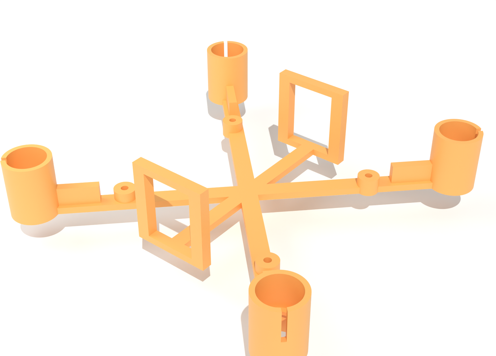
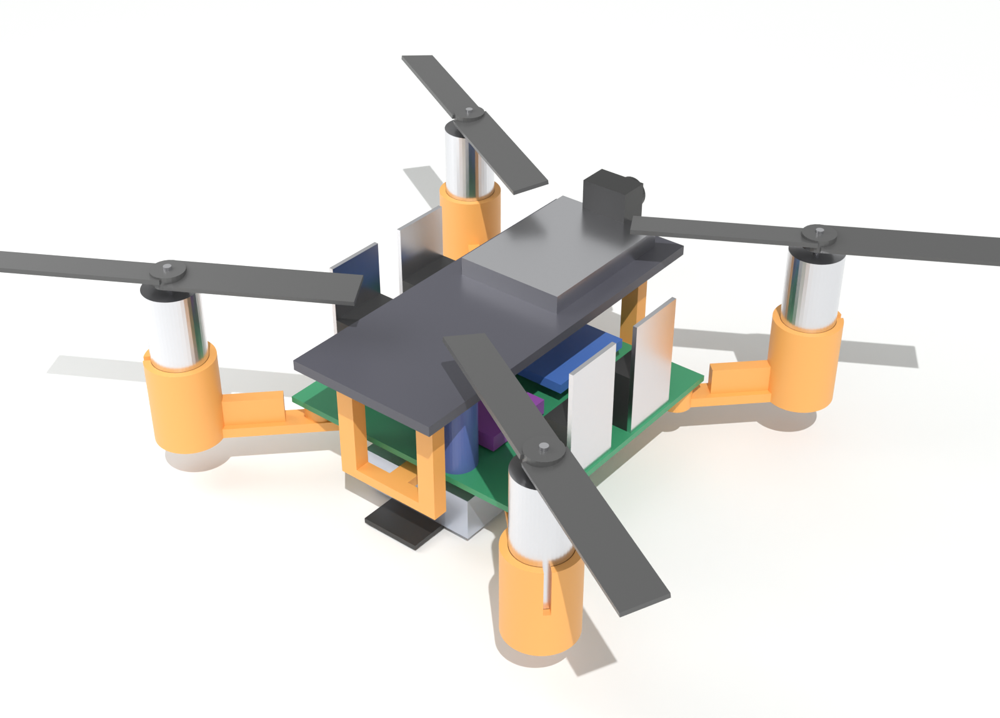

# Frame

One-piece printed frame for the rev B flight-controller board ([pcb/fc](../pcb/fc/README.md)). It weighs about 5.6 g in PLA and measures 78 × 78 × 19 mm, with motors 95 mm apart across the diagonal.

Regenerate the STL with `pcb/.venv/Scripts/python frame/gen_frame.py`. It prints the weight and checks the clearances listed below. Re-render the pictures with `blender --background --python frame/render_frame.py`.

## What it holds

| Part | How |
| --- | --- |
| Motors (8520) | Slide into the clip tubes from the top until they sit on the inner lip; the wires go out through the hole underneath and along the arm to the corner pads. The slit lets the tube grip. |
| PCB | On four posts, 4 mm tall. M2 screws go straight into the 1.7 mm holes. |
| ESP32 | Lies across the two bridges just outside the PCB's front and rear edges, 14 mm above the PCB. Hold it with foam tape or a rubber band. |
| Battery | Underneath, with a velcro strap (up to 10 mm wide) that goes under the battery and over the bottom crossbars of the two bridges. |

## Clearances it checks

- Prop tip to prop tip: 12 mm (55 mm props).
- Props spin about 28 mm above the bed, 4.5 mm over the upright MOSFETs and about 4 mm over the ESP32.
- The motor tubes and arm ribs stay outside the PCB outline.
- 2.4 mm between the beams and the PCB's underside: trim the leads to about 1.5 mm.

## Printing

- PLA or PETG, 0.2 mm layers, 3 walls (the thin parts come out solid), no supports. A brim helps the tall tubes and bridge legs stick.
- Print it as it comes out of the STL: flat side down. The lip inside each tube is chamfered so it needs no support.
- **Test the motor fit first.** If the motors are loose or won't go in, change `TUBE_ID` in `gen_frame.py` (8.6 mm now; try 8.4–8.8) and regenerate.

## Not checked yet

- The ESP32's real size and how it sits on the bridges (assumed 25 × 61 mm).
- Real weights and thrust.
- No prop guards or landing feet yet: it lands on the battery strap.
