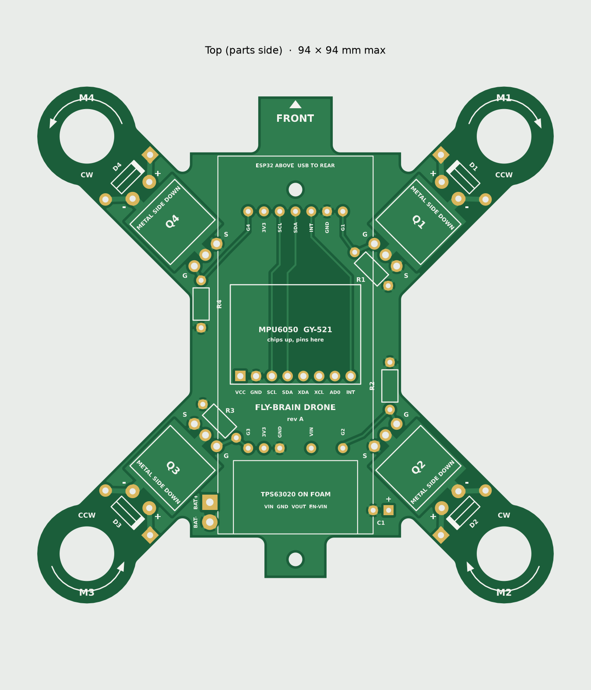

# PCB frame, rev A

The PCB is the drone's frame: an X-shaped, 2-layer board, 83 × 83 mm, about 8.6 g at 1.0 mm thick. It replaces the printed frame, the perfboard and most of the wiring. Every part is through-hole, so it can be hand-soldered.

- **Top (parts side):** MOSFETs, diodes, resistors, capacitor, MPU6050, buck-boost; the ESP32 sits above on spacers. Ground pour.
- **Bottom (battery side):** the battery in a printed tray. The whole bottom layer is the battery plus plane.

Regenerate everything with `pcb/.venv/Scripts/python pcb/gen.py`. It writes `out/`, then prints a clearance, edge, drill and connectivity report. The last run passed all checks, and the netlist matches the design.

## Ordering (JLCPCB or PCBWay)

Upload `out/fly-drone-gerbers.zip` and choose:

| Setting | Value |
| --- | --- |
| Layers | 2 |
| Size | 83.2 × 83.2 mm (detected from the outline) |
| Thickness | 1.0 mm (1.2 mm if you want it stiffer) |
| Surface finish | HASL lead-free |
| Copper | 1 oz |
| Quantity | 5 (the minimum, about the same price) |
| Remove order number | yes, if offered free; otherwise it may be printed on the board |

Boards under 100 × 100 mm usually cost about $2–5 for 5, plus shipping. **Check the factory's online Gerber viewer before paying.** It should show the X shape, four motor holes, two screw holes and 60 plated holes.

## What changes from the perfboard build

| Part | How it mounts now |
| --- | --- |
| Motors | Through the 8.8 mm arm holes in printed collars (8.5 mm inside); glue the collars |
| ESP32-S3 CAM | On two 8 mm printed spacers at the front screw and rear, wired from the jumper pads |
| MPU6050 | Its 8-pin header straight into the board, chips up, square pad = VCC |
| TPS63020 | On foam tape in the outlined rear area, under the ESP32 |
| MOSFETs | Lying flat **metal side down** on their copper pads, legs bent into the 3 holes |
| Battery | Printed tray under the board, held by the 2 M2 screws (front and rear tab) |

You also need to print: 4 motor collars, 2 ESP32 spacers, 1 battery tray.

## Jumper pads to the ESP32

The ESP32 board's pinout couldn't be confirmed from its listing, so signals end at labeled pads instead of going straight into the ESP32. Solder a short wire from each pad up to the matching ESP32 pin:

| Pad | Goes to ESP32 pin | What it is |
| --- | --- | --- |
| G1 | GPIO 21 | Motor 1 gate |
| G2 | GPIO 47 | Motor 2 gate |
| G3 | GPIO 14 | Motor 3 gate |
| G4 | GPIO 38 | Motor 4 gate |
| SCL | GPIO 42 | MPU6050 clock |
| SDA | GPIO 41 | MPU6050 data |
| INT | GPIO 40 | MPU6050 interrupt |
| 3V3 (front) | 3V3 | 3.3 V supply in |
| GND (front) | GND | Ground |

Buck-boost pads (rear row): **VIN** to the module's VIN, **GND** to its GND, **3V3** to its VOUT. Bridge the module's EN pad to its VIN.

## Assembly order

1. Diodes D1–D4 (stripe on the square pad) and resistors R1–R4.
2. MOSFETs: bend the legs 90° about 3 mm from the body, lay the part metal side down on its copper pad, solder the legs.
3. Capacitor C1: + on the square pad, laid flat pointing backward.
4. MPU6050 on its header.
5. Battery pigtail into BAT+ (square) and BAT−, from below.
6. Buck-boost on foam, three wires, EN bridge. **Connect the battery and measure 3.3 V at the 3V3 pad before going on.**
7. Motor leads into + and − at each arm (CW motors usually red/blue, CCW white/black).
8. Short wires from the jumper pads, then mount the ESP32 on its spacers and solder the wires into its pins.
9. Props off: check spin directions (M1 and M3 counter-clockwise, M2 and M4 clockwise). If one is wrong, swap its two motor leads.

## Before ordering, check

- **Motor fit:** 8.5 mm motors in 8.8 mm holes need the printed collars. If you'd rather press-fit motors directly, change `MOTOR_HOLE_D` in `gen.py` to 8.6 and regenerate.
- **Buck-boost size:** the outline assumes about 20 × 12 mm. Measure your module when it arrives.
- **This is rev A and hasn't been built.** My script checks spacing, edges, drills and connections, and I checked the netlist and MOSFET pin order separately. The factory's viewer is a good second check.
