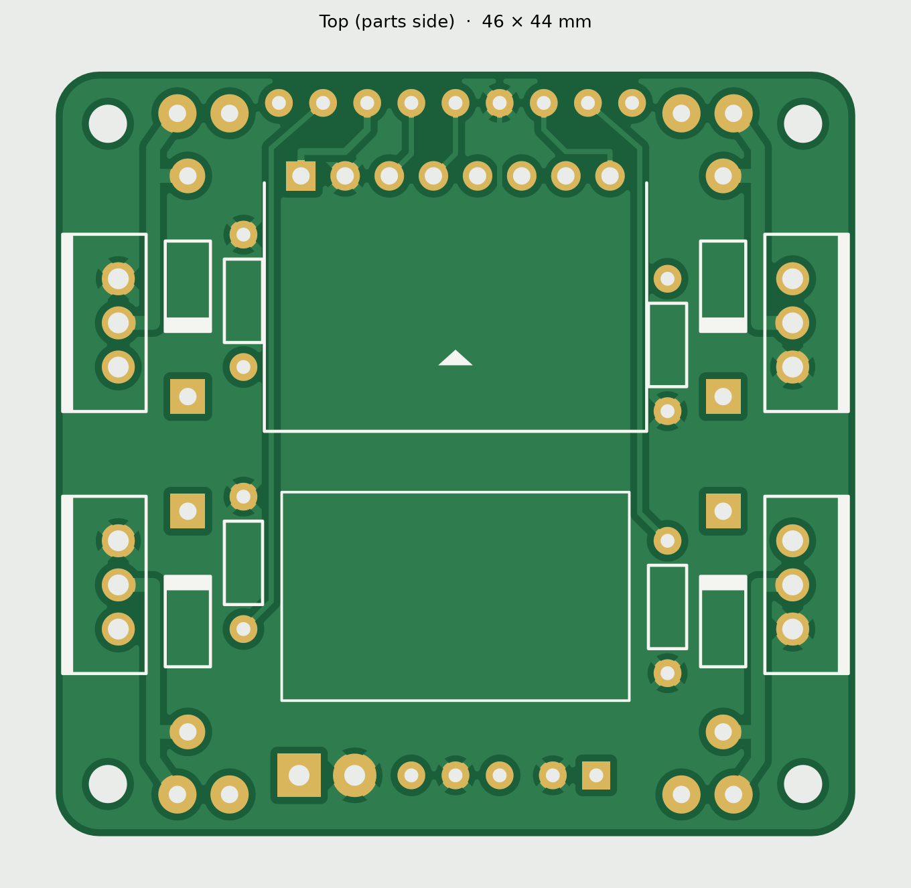

# Flight-controller board, rev B

A small 46 × 44 mm, 2-layer board, about 4.7 g at 1.0 mm thick. It replaces the X-shaped PCB frame (rev A, in `pcb/`): the motors now sit in a 3D-printed frame and their wires come in to pads at this board's corners. Every part is through-hole, so it can be hand-soldered.

The silkscreen has **no text** on purpose: Ayham is adding his own labels in KiCad. Only part outlines, diode stripes, MOSFET tab bars and a front arrow are printed. (To bring back the generator's labels, set `TEXT = True` in `gen.py`.)

- **Top (parts side):** MOSFETs standing along the left and right edges, diodes and resistors beside them, the MPU6050 in the middle, the TPS63020 on foam behind it. Ground pour.
- **Bottom:** battery-plus (VBAT) pour, plus the gate and 3.3 V traces.
- **ESP32:** held above the board by the printed frame, at least 13 mm up so it clears C1 and the MPU6050. The MOSFETs (about 18 mm tall) stand outside its footprint.

Regenerate everything with `pcb/.venv/Scripts/python pcb/fc/gen.py`, then check the netlist with `pcb/.venv/Scripts/python pcb/fc/_net.py`. The last run passed all checks: the generator's clearance, edge, drill and connectivity report; the netlist and MOSFET pin order; and KiCad 10.0.6 DRC (0 errors, 0 unconnected, only "footprint library not found" warnings).

The KiCad project is `kicad/fly-fc.kicad_pro`. Once someone saves the board in KiCad, that file is the master copy and `gen.py` won't overwrite it.

## Ordering

Upload `out/fly-fc-gerbers.zip`. Same settings as rev A: 2 layers, 1.0 mm, HASL lead-free, 1 oz copper, 5 pcs. The factory viewer should show a rounded square, 60 plated holes and 4 unplated corner holes.

## Pads

| Pad | Goes to | What it is |
| --- | --- | --- |
| M1+ / M1− … M4+ / M4− (corners) | Motor wires | + is battery plus, − is switched by the MOSFET |
| G1, G2, G3, G4 (front) | ESP32 GPIO 21, 47, 14, 38 | Motor 1–4 gates |
| SCL, SDA, INT (front) | ESP32 GPIO 42, 41, 40 | MPU6050 |
| 3V3, GND (front) | ESP32 3V3, GND | 3.3 V supply to the ESP32 |
| BAT + / − (rear) | Battery pigtail | |
| OUT, GND, IN (rear) | TPS63020 VOUT, GND, VIN | Bridge the module's EN pad to its VIN |

Motors: M1 front-right CCW, M2 rear-right CW, M3 rear-left CCW, M4 front-left CW.

Front pads, left to right: G4, G3, 3V3, SCL, SDA, GND, INT, G2, G1. Rear pads, left to right: BAT+ (square), BAT−, OUT, GND, IN, C1− and C1+ (square).

## Assembly order

1. Resistors R1–R4, lying flat.
2. Diodes D1–D4, lying flat, stripe on the square pad (the end nearer the middle of the board).
3. MOSFETs Q1–Q4 standing upright, **metal tab toward the board edge** (the white bar on the outline). The printed face looks at the middle of the board.
4. C1 standing, + on the square pad.
5. MPU6050 on its header, chips up, body toward the rear (over the board, not hanging off the front).
6. Battery pigtail into BAT + (square) and −.
7. TPS63020 on foam tape in its outline; three short wires to OUT, GND and IN; EN bridged to VIN. **Connect the battery and measure 3.3 V at the front 3V3 pad before going on.**
8. Screw the board into the frame, then solder the motor wires into the corner pads.
9. Short wires from the front pads up to the ESP32's pins.
10. Props off: check the spin directions. If a motor spins the wrong way, swap its two wires.

## Checked against the real parts (photos with a ruler, 2026-10-26)

- **IRLB8721:** genuine IR part, about 10.5 × 16.6 mm. The MOSFET holes are 1.2 mm so any TO-220 leg fits.
- **GY-521:** pins VCC GND SCL SDA XDA XCL AD0 INT, matching the board. Its header is already soldered on.
- **ESP32-S3 WROOM CAM board:** about 28.5 × 51 mm plus a 7 mm antenna overhang, two rows of 20 pins 25.4 mm apart. Its printed labels include every pin in our plan (GPIO 21, 47, 14, 38, 42, 41, 40, 3V3, GND).
- **8520 motors:** about 8.3 mm across, 20 mm long; CW motors have red/blue leads, CCW white/black.
- **TPS63020 module: about 27.5 × 18.7 mm. It does NOT fit the 20 × 12 mm outline on this board** (the outline is boxed in by the MPU6050 and the resistors). It needs a new spot before ordering. Its pins: GND and VIN at one end, GND and OUT at the other, EN and PS on one long edge, and solder pads to pick 3.3 V, 4.2 V or 5 V. **Bridge the 3V3 pad and measure the output before connecting anything.**

The printed frame is in [frame/](../../frame/README.md).
